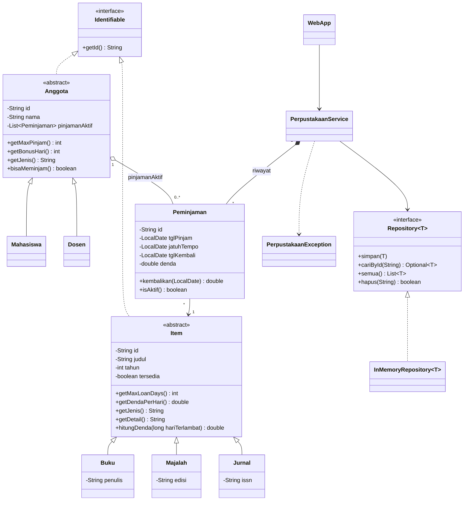

# Mini Sistem Manajemen Perpustakaan

Aplikasi web sederhana berbasis Java untuk mengelola koleksi, anggota, dan peminjaman perpustakaan. Project ini dibuat untuk **Tugas 1 mata kuliah Pemrograman Berorientasi Objek** dengan fokus pada penerapan konsep OOP: class dan responsibility, encapsulation, inheritance, abstraction, polymorphism, generics, dan collections.

| | |
|---|---|
| Mata kuliah | Pemrograman Berorientasi Objek |
| Dosen pengampu | Hardiansyah, S.T., M.Kom |
| Jenis tugas | Individual, mini sistem OOP (project dan laporan) |
| Bahasa | Java 17+ |
| Dependensi | Tidak ada (hanya JDK) |

## Daftar Isi
1. [Fitur](#fitur)
2. [Teknologi](#teknologi)
3. [Cara Menjalankan](#cara-menjalankan)
4. [Aturan Bisnis](#aturan-bisnis)
5. [Arsitektur](#arsitektur)
6. [Class Diagram](#class-diagram)
7. [Penerapan Konsep OOP](#penerapan-konsep-oop)
8. [Alur Peminjaman dan Pengembalian](#alur-peminjaman-dan-pengembalian)
9. [Endpoint Web](#endpoint-web)
10. [Validasi dan Penanganan Error](#validasi-dan-penanganan-error)
11. [Skenario Pengujian](#skenario-pengujian)
12. [Keterbatasan dan Pengembangan Lanjutan](#keterbatasan-dan-pengembangan-lanjutan)
13. [Struktur Project](#struktur-project)

## Fitur

**Koleksi**
- Tambah koleksi dengan tiga jenis: Buku, Majalah, Jurnal
- Cari koleksi berdasarkan judul (tidak membedakan huruf besar dan kecil)
- Hapus koleksi (ditolak jika sedang dipinjam)
- Status koleksi: Tersedia atau Dipinjam

**Anggota**
- Tambah anggota dengan dua jenis: Mahasiswa dan Dosen
- Lihat daftar anggota beserta jumlah pinjaman aktif dan kuotanya

**Transaksi**
- Peminjaman dengan pengecekan ketersediaan koleksi dan kuota anggota
- Pengembalian dengan perhitungan denda keterlambatan otomatis
- Daftar pinjaman aktif dan riwayat seluruh transaksi

## Teknologi

| Komponen | Pilihan | Alasan |
|---|---|---|
| Bahasa | Java 17+ | Syarat tugas, memakai text block dan switch expression |
| Server web | `com.sun.net.httpserver` (bawaan JDK) | Tanpa framework dan Maven, langsung jalan dengan `javac` dan `java` |
| Tampilan | HTML dan CSS yang dirender server | Cukup untuk aplikasi web sederhana |
| Penyimpanan | Collections di memori | Sesuai fokus tugas, tanpa database |

## Cara Menjalankan

**Prasyarat:** JDK 17 atau lebih baru (bukan hanya JRE). Cek dengan `javac -version`.

**PowerShell (Windows / terminal VS Code):**
```powershell
javac -d out (Get-ChildItem -Recurse src -Filter *.java).FullName
java -cp out id.perpus.web.WebApp
```

**Bash (Linux / macOS / Git Bash):**
```bash
javac -d out $(find src -name "*.java")
java -cp out id.perpus.web.WebApp
```

Setelah muncul pesan `Perpustakaan berjalan di http://localhost:8080`, buka alamat tersebut di browser. Tekan `Ctrl + C` di terminal untuk berhenti.

**Memakai port lain** (jika 8080 sudah terpakai):
```powershell
java -cp out id.perpus.web.WebApp 9000
```

**Data awal** (dimuat setiap server dijalankan):

| Koleksi | Anggota |
|---|---|
| `B001` Clean Code (Buku) | `A001` Budi Santoso (Mahasiswa) |
| `B002` Laskar Pelangi (Buku) | `D001` Hardiansyah (Dosen) |
| `M001` Tempo Edisi Khusus (Majalah) | |
| `J001` Jurnal Informatika (Jurnal) | |

## Aturan Bisnis

**Aturan koleksi**

| Jenis | Masa pinjam | Denda per hari terlambat | Atribut khusus |
|---|---|---|---|
| Buku | 14 hari | Rp1.000 | Penulis |
| Majalah | 7 hari | Rp500 | Edisi |
| Jurnal | 3 hari | Rp2.000 | ISSN |

**Aturan anggota**

| Jenis | Kuota pinjaman aktif | Tambahan masa pinjam |
|---|---|---|
| Mahasiswa | 3 | 0 hari |
| Dosen | 5 | 7 hari |

**Rumus**
```
jatuh tempo = tanggal pinjam + masa pinjam koleksi + tambahan masa pinjam anggota
denda       = max(0, tanggal kembali - jatuh tempo dalam hari) x denda per hari koleksi
```

Contoh: Mahasiswa meminjam Buku pada 18 Oktober, jatuh tempo 1 November. Jika dikembalikan 11 November (terlambat 10 hari), denda Rp10.000. Jika Dosen meminjam buku yang sama, jatuh tempo menjadi 8 November.

## Arsitektur

Project memakai tiga lapisan dengan arah dependensi satu arah dari atas ke bawah.

```
 web          WebApp, Html            Menerima request HTTP, merender halaman
  |
 service      PerpustakaanService     Logika bisnis (pinjam, kembali, cari, validasi aturan)
  |
 repository   Repository<T>           Akses data lewat interface
  |
 model        Item, Anggota, ...      Entitas dan aturan milik masing-masing objek
```

Prinsip yang dijaga:
- `WebApp` tidak berisi logika bisnis. Mengganti web dengan tampilan lain (misalnya console) tidak mengubah `service`, `repository`, dan `model`.
- `PerpustakaanService` bergantung pada interface `Repository`, bukan pada `InMemoryRepository`. Penyimpanan dapat diganti ke database tanpa mengubah service.
- Aturan yang melekat pada objek berada di objek itu sendiri: denda di `Item`, kuota di `Anggota`, perhitungan jatuh tempo di `Peminjaman`.

## Class Diagram

Diagram berikut tampil otomatis di GitHub. Versi PlantUML ada di [`docs/class-diagram.puml`](docs/class-diagram.puml).



## Penerapan Konsep OOP

| Konsep | Penerapan | Lokasi |
|---|---|---|
| **Class dan responsibility** | Setiap class punya satu tanggung jawab: `Item` menyimpan data dan aturan koleksi, `Peminjaman` mencatat satu transaksi, `PerpustakaanService` mengatur alur bisnis, `InMemoryRepository` menyimpan data, `WebApp` melayani HTTP | seluruh package |
| **Encapsulation** | Semua field `private`, akses lewat getter. Setter memvalidasi nilai (judul tidak kosong, tahun 1450 sampai tahun berjalan). Daftar pinjaman anggota dikembalikan sebagai `unmodifiableList`, dan perubahannya hanya lewat method package-private `tambahPinjaman` dan `hapusPinjaman` | `Item`, `Anggota` |
| **Inheritance** | `Buku`, `Majalah`, `Jurnal` mewarisi `Item`. `Mahasiswa` dan `Dosen` mewarisi `Anggota` | `model` |
| **Abstraction** | `Item` dan `Anggota` adalah abstract class dengan method abstrak yang wajib diisi subclass. `Identifiable` dan `Repository<T>` adalah interface | `model`, `repository` |
| **Polymorphism** | `getMaxLoanDays()`, `getDendaPerHari()`, `getMaxPinjam()`, dan `getBonusHari()` di-override berbeda tiap subclass. `Peminjaman` dan `PerpustakaanService` hanya memegang tipe `Item` dan `Anggota`, lalu perilaku yang tepat terpilih saat runtime | `Peminjaman`, `PerpustakaanService` |
| **Generics** | `Repository<T extends Identifiable>` dan `InMemoryRepository<T>` dipakai ulang untuk `Item` dan `Anggota` | `repository` |
| **Collections** | `LinkedHashMap` (penyimpanan berdasarkan ID, urutan input terjaga), `ArrayList` (riwayat transaksi dan pinjaman aktif), `List` dan `Optional` pada API repository | `InMemoryRepository`, `PerpustakaanService` |
| **Hubungan antarclass** | *Association*: `Peminjaman` ke `Anggota` dan `Item`. *Aggregation*: `Anggota` ke `Peminjaman` aktif. *Composition*: service memiliki riwayat transaksi. *Dependency*: service ke repository, web ke service | seluruh package |
| **Exception handling** | `PerpustakaanException` untuk pelanggaran aturan bisnis. `IllegalArgumentException` untuk input tidak valid | `service`, `model` |

Contoh polymorphism pada `hitungDenda`:

```java
// Item.java: satu method, perilaku berbeda tergantung subclass
public double hitungDenda(long hariTerlambat) {
    return hariTerlambat > 0 ? hariTerlambat * getDendaPerHari() : 0;
}
// Buku: 1.000 | Majalah: 500 | Jurnal: 2.000
```

## Alur Peminjaman dan Pengembalian

**Peminjaman** (`PerpustakaanService.pinjam`)
1. Cari anggota dan koleksi berdasarkan ID. Jika tidak ada, tolak.
2. Tolak jika koleksi sedang dipinjam.
3. Tolak jika kuota anggota penuh.
4. Buat `Peminjaman`: hitung jatuh tempo, ubah status koleksi menjadi Dipinjam, tambahkan ke pinjaman aktif anggota.
5. Simpan ke riwayat dan kembalikan hasilnya.

**Pengembalian** (`PerpustakaanService.kembali`)
1. Cari transaksi berdasarkan ID (contoh `TRX-001`). Jika tidak ada, tolak.
2. Tolak jika transaksi sudah dikembalikan atau tanggal kembali lebih awal dari tanggal pinjam.
3. Hitung denda dari selisih hari terhadap jatuh tempo.
4. Ubah status koleksi menjadi Tersedia dan keluarkan dari pinjaman aktif anggota.

## Endpoint Web

| Method | Path | Fungsi | Parameter |
|---|---|---|---|
| GET | `/` | Halaman utama | `q` (opsional, kata kunci judul), `ok` / `err` (pesan hasil) |
| POST | `/item/tambah` | Tambah koleksi | `jenis` (`buku`/`majalah`/`jurnal`), `id`, `judul`, `tahun`, `extra` (penulis/edisi/ISSN) |
| POST | `/item/hapus` | Hapus koleksi | `id` |
| POST | `/anggota/tambah` | Tambah anggota | `jenis` (`mahasiswa`/`dosen`), `id`, `nama` |
| POST | `/pinjam` | Pinjam koleksi | `anggota`, `item`, `tanggal` (opsional, kosong = hari ini) |
| POST | `/kembali` | Kembalikan koleksi | `trx`, `tanggal` (opsional, kosong = hari ini) |

Setiap aksi POST memakai pola *Post/Redirect/Get*: server membalas dengan redirect `303` ke `/` membawa pesan hasil, sehingga refresh halaman tidak mengulang aksi.

## Validasi dan Penanganan Error

| Kondisi | Respons |
|---|---|
| ID koleksi atau anggota sudah terdaftar | Ditolak dengan pesan |
| Judul, nama, ID, atau atribut khusus kosong | Ditolak |
| Tahun terbit di luar 1450 sampai tahun berjalan | Ditolak |
| Koleksi sedang dipinjam (pinjam atau hapus) | Ditolak |
| Kuota pinjaman anggota penuh | Ditolak, pesan menyebut kuota |
| Transaksi tidak ditemukan atau sudah dikembalikan | Ditolak |
| Tanggal kembali sebelum tanggal pinjam | Ditolak |
| Format tanggal tidak valid | Ditolak |
| Path tidak dikenal | HTTP 404 |

Semua teks dari pengguna di-*escape* sebelum ditampilkan sebagai HTML, sehingga input seperti `<b>` tampil sebagai teks biasa (pencegahan XSS).

## Skenario Pengujian

Gunakan data awal. Kolom "Hasil" adalah pesan yang tampil di halaman.

| No | Skenario | Langkah | Hasil yang diharapkan |
|---|---|---|---|
| 1 | Pinjam koleksi tersedia | Pinjam `B001` oleh `A001` | `Berhasil`, `B001` berstatus Dipinjam |
| 2 | Pinjam koleksi yang sedang dipinjam | Pinjam `B001` lagi | `Koleksi sedang dipinjam` |
| 3 | Kembali tepat waktu | Kembalikan tanpa isi tanggal | `Denda: Rp0` |
| 4 | Kembali terlambat | Pinjam `B001`, kembalikan 10 hari setelah jatuh tempo | `Denda: Rp10.000` |
| 5 | Denda berbeda per jenis | Pinjam `J001`, kembalikan 2 hari setelah jatuh tempo | `Denda: Rp4.000` |
| 6 | Kuota mahasiswa penuh | `A001` meminjam 3 koleksi, lalu coba pinjam ke-4 | `Kuota pinjam Budi Santoso penuh (3)` |
| 7 | Bonus masa pinjam dosen | Pinjam `B002` oleh `D001` | Jatuh tempo 21 hari setelah tanggal pinjam |
| 8 | Hapus koleksi sedang dipinjam | Hapus koleksi berstatus Dipinjam | `Koleksi sedang dipinjam, tidak bisa dihapus` |
| 9 | Tambah koleksi dengan ID ganda | Tambah koleksi ber-ID `B001` | `ID koleksi sudah terdaftar: B001` |
| 10 | Validasi tahun | Tambah koleksi dengan tahun `1200` | `Tahun terbit tidak valid: 1200` |
| 11 | Cari koleksi | Cari `laskar` | Hanya Laskar Pelangi pada tabel |
| 12 | Input berbahaya | Tambah koleksi berjudul `<b>Tes</b>` | Tampil sebagai teks `<b>Tes</b>`, bukan huruf tebal |
| 13 | Tanggal kembali tidak logis | Kembalikan dengan tanggal sebelum tanggal pinjam | `Tanggal kembali tidak boleh sebelum tanggal pinjam` |

## Keterbatasan dan Pengembangan Lanjutan

**Keterbatasan saat ini**
- Data hanya di memori, sehingga kembali ke data awal setiap server dijalankan ulang.
- Belum ada login atau pembedaan peran (admin dan anggota).
- Server memproses request satu per satu, cukup untuk pemakaian lokal dan demonstrasi.
- Tanggal pinjam memakai hari ini, kecuali diisi manual pada form.

**Pengembangan yang mungkin**
- Penyimpanan permanen dengan implementasi `Repository` baru (file JSON atau database) tanpa mengubah service.
- Fitur edit data koleksi dan anggota.
- Pembedaan peran admin dan anggota.
- Unit test untuk `Peminjaman` dan `PerpustakaanService`.
- Migrasi ke Spring Boot dengan `PerpustakaanService` sebagai bean.

## Struktur Project

```
.
├── README.md
├── .gitignore
├── docs/
│   └── class-diagram.puml
└── src/main/java/id/perpus/
    ├── model/
    │   ├── Identifiable.java       interface identitas
    │   ├── Item.java               abstract: koleksi
    │   ├── Buku.java
    │   ├── Majalah.java
    │   ├── Jurnal.java
    │   ├── Anggota.java            abstract: anggota
    │   ├── Mahasiswa.java
    │   ├── Dosen.java
    │   └── Peminjaman.java         transaksi pinjam dan kembali
    ├── repository/
    │   ├── Repository.java         interface generik
    │   └── InMemoryRepository.java
    ├── service/
    │   ├── PerpustakaanService.java
    │   └── PerpustakaanException.java
    └── web/
        ├── WebApp.java             server, routing, halaman
        └── Html.java               escape HTML dan parsing form
```
